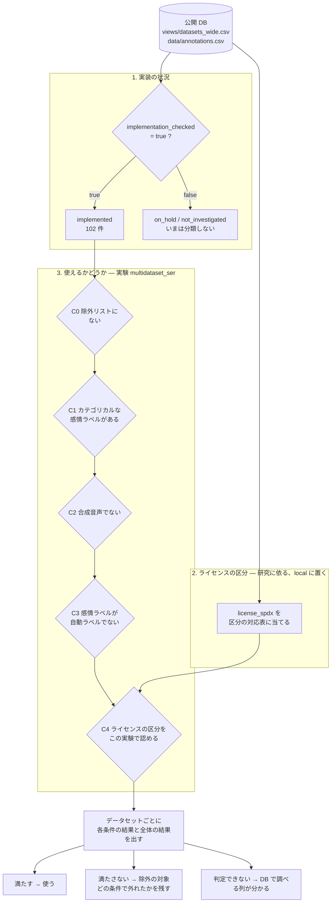

# 0002 `espnet_status` の分離: 実装の状況と、研究で使うかどうか

状態: 決定(2026-11-04。実装の状況は 3 値に、研究への利用はデータセットの選別の道具に。経過は 8 節)
関連: [plans/0001](../plans/0001-remaining-data-work.md)、[discussions/0001](0001-verification-pr-tool.md)
最終更新: 2026-11-04

対象は `local/dataset_use.csv`(git 管理外)の `espnet_status` 列。この文書は **構造と件数だけ** を書く。どのデータセットを使うかという個別の判断は、公開リポジトリには書かず `local/` に置く(DB は事実だけを記録する、という規則のため)。

## 1. 問題

`espnet_status` は 5 つの値(`implemented`、`candidate`、`deferred`、`needs_decision`、`excluded`)の 1 列で、**性質の違う 3 種類のことを同時に表している**。そのため、1 つの値からは次のことが読み取れない。

- そのデータセットを **実装しようとしたのか、したのか**(実装の状況)
- **手に入ったのか、手に入らなかったのか**(入手できるか)
- **研究に使うのか、使わないのか**(研究の判断)

例: `excluded` の 42 件は、「音声が無くて実装できない」ものと、「実装は可能だが、研究では使わない」ものが混ざっている。`implemented` も、「レシピがある」ことしか表さず、「使う」とは限らない(レシピは作ったが使わないものが 1 件ある。そのためレシピは 102 件、`implemented` は 101 件で、数が合わない)。

## 2. 今の値と、理由のコード

`status_reason_codes` に、理由のコードが入っている。これを 3 つの軸に分けて数えた(2026-11-04、318 行)。

| 軸 | 何を表すか | コード |
|---|---|---|
| A 調査の深さ | どこまで調べたか | `unexamined`、`first_review_done`、`not_individually_checked` |
| B 入手できるか | 配布の状態 | `access_*`(ゲート、申込フォーム、署名、有料、直接ダウンロードなし)、`host_unreachable`、`not_distributable`、`access_restricted_region`、`audio_links_only`、`no_audio_paper_only`、`no_audio_code_only`、`no_raw_audio_features_only`、`text_only`、`redistribution_of_existing_corpus`、`duplicate_entry` |
| C 研究の判断 | ラベルなどを理由に使わない | `labels_automatic`、`labels_from_text_content`、`labels_not_discrete_emotion`、`labels_style_not_emotion` |

| `espnet_status` | 件数 | 軸 A のみ | 軸 B のみ | 軸 C のみ | B と C の両方 |
|---|---|---|---|---|---|
| `implemented` | 101 | (コード無し) | | | |
| `candidate` | 134 | 80 | 46 | 5 | 3 |
| `deferred` | 34 | 18 | 16 | | |
| `needs_decision` | 7 | | 6 | | 1 |
| `excluded` | 42 | | 38 | 2 | 2 |

わかること:

- **`excluded` の大半(42 件中 38 件)は、研究の判断ではなく、入手できない・音声が無いという事実(軸 B)。** これを「使わない」と同じ列に入れているのが混在の中心。
- **`candidate`(134 件)の約 6 割(80 件)は、まだ調べていない(軸 A)。** 「候補」は状態ではなく、「調査待ち」を意味している。
- **軸 C(研究の判断)のコードを持つ行は 13 件**(単独 7、軸 B との組み合わせ 6。単独 7 件の中に、レシピがあって使わない 1 件を含む)。研究の判断として本来の中身はこれだけ。
- **`deferred`(34 件)と `needs_decision`(7 件)の違いが理由で決まっていない。** 前者は「入手方法を確認できない」、後者は「入手できるが判断が要る」という意味で使われている。

## 3. 混ざっていると困ること

1. **数が合わない。** レシピの数(102)と `implemented`(101)の違いを、説明なしに読み取れない。
2. **実装の優先順位が付けられない。** 「次に実装できるもの」は、入手できる(軸 B)かつ、使う(軸 C)ものだが、1 列では絞り込めない。
3. **判断の理由が見えにくい。** 入手できないから外した、と、入手できるが使わないことにした、は後で見直す条件が違う。前者は状況が変われば戻せる。後者は研究の方針が変われば戻せる。
4. **学習用か評価用かを足す場所が無い。** 次に決めたい割り当て(学習・評価・使わない)は、実装の状況とは別の軸なので、同じ列には入れられない。
5. **方針との食い違いを見つけにくい。** 「ラベルの種類や自動ラベルは、除外の理由にしない」という maintainer の方針(2026-10-14)があるが、軸 C のコードで `excluded` になっている行が 4 件ある。これらが方針のあとに付いたのか、前の判断が残っているのかは、列が混ざっているために判別できない。

## 4. 決定: 実装の状況(2026-11-04、maintainer)

### 4.1 決定

実装の状況は、次の **3 つの値だけ** にする。`espnet` の実装がどうなっているかだけを伝え、研究に使うかどうかは含めない。

| 値 | 意味 |
|---|---|
| 実装済み | レシピがある。研究に使うかどうかは問わない(レシピがあって使わない `bari_emospeech` もここに入る) |
| 保留 | 入手できない、問題があるなどの理由で、実装できないと判断されたもの。理由は理由のコードで残す |
| 未調査 | まだ実装の可否を調べていない |

研究への利用状況は、別のファイル・別の軸で扱う。細部(値、役割、理由の持ち方)は、まだ決まっていないので待つ。

### 4.2 理由

- 「実装した」と「使う」は別のことで、混ぜると数が合わなくなる(レシピ 102 に対して `implemented` が 101、という食い違いが起きた)。
- 「実装済み」を、レシピがあるかどうかだけで決めれば、`egs3` を調べて機械的に照合できる。
- 実装の状況が 3 つなら、一覧を見て「今、何ができるか、何が止まっているか、何が手つかずか」がすぐ分かる。細かい違い(入手方法の種類など)は、理由のコードに任せる。

### 4.3 今の値からの移し方(案)

| 今の値 | 件数 | 移し先 | 備考 |
|---|---|---|---|
| `implemented` | 101 | 実装済み | |
| `excluded` で、レシピのある `bari_emospeech` | 1 | 実装済み | 使うかどうかは、研究の利用状況の側で扱う |
| `excluded` のうち、上の 1 件以外 | 41 | 保留 | 理由のコード(音声が無い、地域制限、重複など)をそのまま残す |
| `deferred` で入手の問題を理由にもつもの | 16 | 保留 | |
| `deferred` で、まだ調べていないもの | 18 | 未調査 | |
| `candidate` で、まだ調べていないもの | 80 | 未調査 | |
| **`candidate` で、入手方法が分かっているもの** | 49 | **未調査(案)** | 下の 5-1 |
| **`candidate` で、ラベルの種類だけが理由のもの** | 5 | **未調査(案)** | 下の 5-2 |
| **`needs_decision`** | 7 | **保留(案)** | 下の 5-3 |

## 5. 決定: 移し方の細部(2026-11-04、maintainer)

| 問い | 決定 | 理由 |
|---|---|---|
| 5-1 `candidate` で入手方法が分かっているもの(49) | 実装の状況は **未調査**。「候補かどうか」は研究への利用状況(2 つ目の表)で扱う | 候補かどうかは研究の計画で決まり、実装の状況ではない |
| 5-2 `candidate` でラベルの種類だけが理由のもの(5) | **未調査** | 実装の可否を判断していない |
| 5-3 `needs_decision`(7) | **保留** | |
| 5-4 実装済みかどうかの決め方 | **DB の情報からスクリプトで決める**(`views/datasets_wide.csv` の `implementation_checked`。recipe の readme が資料として登録されていれば true。2026-11-04 に 102 件で、レシピの数と一致) | 手で書くと数がずれる。DB は readme を資料として持っているので、それで足りる |
| 5-5 値の名前 | `implemented` / `on_hold` / `not_investigated` | |

## 6. 研究への利用状況: 条件による分類(案、検討中)

### 6.1 maintainer の方針(2026-11-04)

- 未実装のうち何を **候補** にするか、実装済みのうち何を **除外** にするかは、**DB の情報を使った条件で、再現できる形で分類する。**
- 条件は、まず大まかに 3 つ。あとで細かい条件を足せるようにする。
  1. パラ言語情報が含まれている
  2. 合成音声のデータではない
  3. ライセンスが明確(open でも nc でもよい。明確であればよい)
- 分類はスクリプトで検証できるようにする。

### 6.2 案: 条件ごとに 3 つの結果を出す

DB には空欄(未確認)が多いので、条件ごとに **満たす / 満たさない / 判定できない(DB が未確認)** の 3 つを返す。判定できないものを「満たさない」に入れると、DB の調査不足が、研究の判断に化けてしまう。

| 条件 | DB で見る列 | 満たす | 満たさない | 判定できない |
|---|---|---|---|---|
| 1 パラ言語情報 | `annotation_items` | 決めた項目(下の 6.4-6)の組が 1 つ以上ある | 組はあるが、どれも該当しない | 組が登録されていない |
| 2 合成音声でない | `speech_production`、`material_origin`、`label_source` | 値があり、`synthetic` / `synthesis_specified` を含まない | どれかが合成を示す | どれも空欄か `unknown` |
| 3 ライセンスが明確 | `license_spdx` | SPDX か `LicenseRef-*` | `unknown`、`none_stated`、`conflicting` | 空欄 |

- **全体の結果:**
  - どれか 1 つでも「満たさない」なら、満たさない。
  - そうでなく、どれか 1 つでも「判定できない」なら、判定できない。
  - 全部「満たす」なら、満たす。
- **候補:** 未実装で、全体が「満たす」もの。
- **除外の対象:** 実装済みで、全体が「満たさない」もの。
- **判定できないもの:** DB の調査の優先順位になる。どの列を調べれば分類が決まるかが、そのまま分かる。

### 6.3 試しに数えた結果(2026-11-04、DB の今の値)

| | 件数 | 満たす | 満たさない | 判定できない |
|---|---|---|---|---|
| 実装済み | 102 | 83 | 14(ライセンスが不明確 11、合成音声 3) | 5 |
| 未実装 | 216 | 50 | 45 | 121 |

- 実装済みで「満たさない」の 14 件には、よく使われるコーパスが入る(ライセンスが `none_stated` や `conflicting` のもの)。条件 3 の線の引き方で、結果が大きく変わる(6.4-1)。
- 未実装の半分以上は、判定できない。多くは、ラベルの組・ライセンス・発声のしかたが DB で空欄のため。

### 6.4 決めてほしいこと

1. **条件 3 の「明確」に、`none_stated`(資料にライセンスの記述が無い)と `conflicting`(資料が食い違う)を入れないことでよいか。**
   - 入れなければ、実装済みのよく使われるコーパスが除外の対象になる。
   - 「資料に記述は無いが、配布元が研究利用を認めている」ものをどう扱うかも決める必要がある。
2. ~~条件を足すか~~ → **決定(2026-11-04、maintainer)。下の 6.5 を参照。**
3. ~~個別の例外を認めるか~~ → **決定。6.5 の除外リストに一本化する。**
4. **入れない条件の確認。** これまでの方針で除外の理由にしないと決めたものは、条件に入れない。
   - 自動ラベル
   - 手作業の入手手続き
   - 規模の小ささ
   - 演技かどうか
   - 感情でないパラ言語ラベル(意図、話し方など)
5. **置き場所。** 条件はスクリプト(`local/` の 1 ファイル)で書き、結果を `local/` の利用状況の表に出す。
   - 学習・評価の役割は、その表に別の列で足す。
   - 手で書くのは、例外と役割だけ。
6. **条件 1 の「パラ言語情報」の項目。** どの組を該当とするか。案は次のとおり。
   - `emotion_categories`、`emotion_attributes`、`speaking_style`、`sentiment`、`intent`、`listener_ratings`

### 6.5 決定: 条件を 4 つにする(2026-11-04、maintainer)

| 案 | 決定 | 理由 |
|---|---|---|
| a 音声が配布されている | 条件にしない | 実装の段階でふるいにかけられている。音声が無ければ実装できず、`on_hold` になる |
| c 自分たちが入手できるか(有料、地域の制限) | 条件にしない | 同じく実装の段階でふるいにかけられ、`on_hold` になっている |
| b 他のデータセットの写しや一部でない | **条件 4「ユーザーが用意した除外リストに含まれていない」として足す** | 写しのどちらを残すかは、個別の判断が要り、DB の値だけでは決められない |

**除外リスト**(`local/` に置く。DB には書かない)

- 個別の判断で除外が必要なデータセットを並べる。
  - 例: 試聴して、声に感情の差が無いと判断したもの。
  - 例: 別のデータセットの再配布で、要らない方。
- 1 行ごとに、理由と、根拠になる DB の行(`issues`、`relations` など)を書く。
- 条件 1〜3 で決まるものは、このリストに入れない。リストは、条件で決められないものだけにする。

**この決定から導かれること(確認待ち)**

- 音声の有無や入手の可否を `on_hold` に任せるなら、**候補は、未実装のうち `not_investigated` から選ぶ。**
- `on_hold` は、状況が変わって実装の状況が戻るまで、候補にしない。

### 6.6 残っている問い

- 6.4-1: 条件 3 で、`none_stated` と `conflicting` を「明確でない」とするか。
- 6.4-4: 入れない条件の確認。
- 6.4-5: 置き場所。
- 6.4-6: 条件 1 の項目。
- 6.5 の「候補は `not_investigated` から選ぶ」でよいか。

## 7. 決定と見直し(2026-11-04、maintainer、続き)

### 7.1 決定

| 問い | 決定 | 理由 |
|---|---|---|
| 「パラ言語情報が含まれている」 | **条件から外し、除外リストで扱う** | 含まれない例はまれで、DB の値から自動で決めるのが難しい |
| カテゴリカルな感情ラベル | **条件に足す: カテゴリカルな感情ラベル(`emotion_categories`)の組を持つ** | 「パラ言語情報があるか」と「カテゴリカルな感情ラベルがあるか」は別の問い。後者は DB から書ける。sentiment などだけのデータセットはここで外れる |
| 自動ラベル | **条件に足す: 主のラベルが自動で付けられたものではない** | この実験では、自動ラベルは除外の対象(DB に登録するかどうかの方針とは別。DB には今まで通り登録する) |
| 手作業の入手手続き、規模の小ささ、演技かどうか | 条件にしない | 関係しない |
| 除外リスト | 1 行ごとに、**理由を明確に書く** | 条件で決まらない判断なので、後で読む人が理由をたどれるようにする |
| 順番 | **実装の状況 → ライセンスの区分 → 使えるかどうか** | 条件 3(ライセンス)は、ライセンスの区分が決まっていないと判断できない |
| 対象(2026-11-04 改) | **いまは実装済みの 102 件だけを分類する。** `not_investigated` から候補を選ぶ流れは、いったん外す | 候補にするかどうかは、別の判断が要りそう |
| 除外リストの位置(同) | **最初に見る** | 個別の判断で外すものは、他の条件を見るまでもない |
| ライセンスの区分の性質(同) | **研究に依る。** だから区分は `local/` に置く | たとえば CC BY-SA を open として扱うかは、人によって違う。open かそれ以外か、だけでは足りない場合がある |
| 置き場所 | `local/` の中を、いくつかのフォルダに分ける。この分類は特定の実験のためなので、**実験のフォルダ**(例 `multidataset_ser`)に置く | 実験ごとに条件が違いうる |

### 7.2 流れ(案、2026-11-04 改)



- **すべての条件を評価する。** 途中で満たさないものが出ても止めず、条件ごとの結果を残す(どの条件で外れたかが分かるように)。順番は、表示と読む順のため。
- **条件ごとの結果は 3 つ:** 満たす / 満たさない / 判定できない(DB が未確認)。
- **全体の結果:**
  - 1 つでも「満たさない」なら、満たさない。
  - そうでなく、1 つでも「判定できない」なら、判定できない。
  - 全部「満たす」なら、満たす。

### 7.3 各ステップで外れるもの

「明示」は、そのステップの条件そのものが外すもの。「暗黙」は、条件には書いていないが、そのステップを通る時点で結果として外れているもの。

| ステップ | 見るもの(DB と local) | 明示的に外れる | 暗黙に外れる | 判定できない |
|---|---|---|---|---|
| 1 実装の状況 | DB の `implementation_checked`(recipe の readme が資料として登録されている)、`local/implementation/on_hold.csv` | レシピの無いもの | 音声が配布されていない(テキスト・特徴量・リンクだけ、論文・コードだけ)、入手できない(地域の制限、配布されていない、配布元に繋がらない、有料・手続きが確認できない)、既存コーパスの再配布・重複。どれも実装できないので `on_hold` になる | — |
| C0 除外リスト | `local/experiments/multidataset_ser_01/exclusion_list.csv` | リストにあるもの(理由はリストに書く) | パラ言語情報が無いもの、声ではなく文の意味でラベルが付いているもの、再配布のうち要らない方(どれもリストに書いて外す) | 無い |
| C1 カテゴリカルな感情ラベル | `annotations.csv` の `item` が `emotion_categories`(主の組でなくてよい。`labels` が `none` なら無いとみなす) | ラベルの組が sentiment・intent・話し方・次元だけのもの | — | ラベルの組が DB に無い |
| C2 合成音声でない | `speech_production`・`material_origin` に `synthetic`、`label_source` が `synthesis_specified` | 合成音声(一部だけ合成でも外す) | — | 両方とも空欄か `unknown`、または `conflicting` |
| C3 自動ラベルでない | 主の組の付け手(`label_source`)と `label_verification` | 自動ラベルで、人の確認が無いもの | — | 付け手が空欄か `unknown`。**`mixed` は満たす。自動でも人が確認した(`human_reviewed`)ものは満たす** |
| C4 ライセンスの区分 | `license_spdx` を `local/license/class_map.csv` で区分にした結果 | 認めない区分: `share_alike`、`noncommercial_share_alike`、`other`、`unclear` | — | `license_spdx` が空欄(今の実装済みには無い) |

- 共通: DB の値は views の今の値(`current` と `conflicting` の行)だけを使う。`;` 区切りは 1 つずつ見る。DB が `conflicting` の値は、どちらかに決めず「判定できない」にする(C4 だけは 7.6 の決まりで区分にする)。
- すべての条件を評価し、どの条件で外れたかを結果に残す。

### 7.3.1 今の数(2026-11-04、`local/experiments/multidataset_ser_01/summary.md` から)

| ステップ | 残り | ここで外れる | ここで判定できない(脇に置く) |
|---|---|---|---|
| DB のデータセット全体 | 318 | | |
| 1 実装の状況 | 102 | 216(`on_hold` 64、`not_investigated` 152) | |
| C0 除外リスト | 101 | 1 | 0 |
| C1 カテゴリカルな感情ラベル | 101 | 0 | 0 |
| C2 合成音声でない | 92 | 3 | 6 |
| C3 自動ラベルでない | 85 | 1 | 6 |
| C4 ライセンスの区分 | **61** | 24 | 0 |

- 全体(各条件を独立に評価): 満たす 61、満たさない 31、判定できない 10。
- 1 で `on_hold` になった 64 件の理由の内訳: 音声が配布されていない 29、入手できない 15、入手手続きが確認できない・有料など 13、再配布・重複 6、ラベルの理由 1(以前の状態の値に研究の判断が混ざっていたもの)。
- C4 で外れる 24 件の内訳: `share_alike` 8、`noncommercial_share_alike` 8、`unclear` 7、`other` 1(C2・C3 で先に外れたものや、判定できずに脇に置いたものは数えていない)。

### 7.4 置き場所(2026-11-04 に作った)

> 2026-11-04 追記: 実験の分類は `local/dataset_filtering/` に作り直した(設定 `config/<実験名>.yaml`、除外リストも設定の中、結果は `output/<実験名>/`)。下の `local/experiments/` の配置と C0〜C4 の名前は当時のもの。

```
local/
  README.md
  dbread.py                     DB の表を読む共通の関数
  check_sync.py                 local の一覧と DB の対応、未対応のライセンスの値を確かめる
  implementation/               1. 実装の状況
    on_hold.csv                 保留の一覧(dataset_id、理由のコード、メモ、日付、以前の状態)
    status.py → status.csv      3 つの値
  license/                      2. ライセンスの区分(研究に依る)
    classes.csv                 区分の定義と厳しさの順
    class_map.csv               license_spdx → 区分
    classify.py → result.csv
  experiments/
    multidataset_ser_01/        3. この実験で使えるかどうか
      README.md                 目的、条件、認めるライセンスの区分、実行の手順
      exclusion_list.csv        除外リスト(dataset_id、理由、根拠の DB の行、日付)
      classify.py → result.csv、summary.md
  verification_tools/           道具ができたら消す(plans/0002)
```

- ライセンスの区分は研究に依る。同じ研究の中で実験ごとに区分の付け方が変わることは少ないと考え、`license/` に置いた。実験ごとに変わるのは、どの区分を認めるか(C4)だけ。区分の付け方そのものが実験で変わるなら、実験のフォルダに移す。
- `.csv` の結果(`status.csv`、`result.csv`、`summary.md`)は生成物。手で書かない。
- 以前の `dataset_use.csv` と `license_class.*` は、まだ残している(7.7-6)。

### 7.5 決定(2026-11-04、maintainer)

| 問い | 決定 |
|---|---|
| ライセンスの区分 | 一般にオープンライセンスと呼ばれるものだけを `open` にする。**SA(継承)系は除外する。** → **[議論 0003](0003-license-classes.md) で見直し中**(ライセンスが明確なら何でも使ってよく、区分は学習・評価の役割を決めるため、という前提が後で示された) |
| `conflicting` のライセンス | 厳しい方(NC など)の区分をとる。どちらも同じような区分なら問題ない |
| `none_stated`、`unknown` | 除外する(区分 `unclear`) |
| `mixed` の付け手 | 例を見てから決める。スクリプトでは、ひとまず満たすにする |
| 自動ラベル | 人がラベルの品質を確認しているなら(`human_reviewed`)満たす。完全に自動のものだけ外す |
| 実験のフォルダ名 | 番号を付けて `multidataset_ser_01`。どの研究も複数のデータセットを使うので良い名前ではないが、ひとまずこれで |

### 7.6 ライセンスの区分(`local/license/`)

区分の定義は `classes.csv`、SPDX との対応は `class_map.csv`。`rank` が大きいほど厳しい。`conflicting` は、食い違う記述の区分のうち、`rank` の大きい方をとる(`none_stated` / `unknown` の記述は、他に記述があれば無視する)。

| 区分 | rank | 意味 | 含まれる `license_spdx` | DB 全体 | 実装済み | この実験 |
|---|---|---|---|---|---|---|
| `open` | 0 | 目的を問わず使える。帰属表示まで(継承・非営利の条件なし) | CC0-1.0、CC-BY-3.0、CC-BY-3.0-US、CC-BY-4.0、MIT、Apache-2.0、ODC-By-1.0 | 89 | 57 | 認める |
| `share_alike` | 1 | 目的を問わないが、改変物を同じ条件で公開する | CC-BY-SA-4.0、GPL-3.0-only、GPL-3.0-or-later、ODbL-1.0、LicenseRef-golos-public(DB の注記: CC BY-SA 4.0 の改変版) | 10 | 9 | 認めない |
| `noncommercial` | 2 | 非営利のみ | CC-BY-NC-3.0、CC-BY-NC-4.0、CC-BY-NC-ND-4.0 | 23 | 5 | 認める |
| `noncommercial_share_alike` | 3 | 非営利のみ、かつ継承 | CC-BY-NC-SA-2.0、CC-BY-NC-SA-3.0-DE、CC-BY-NC-SA-4.0 | 16 | 8 | 認めない(SA 系) |
| `research_only` | 4 | 研究利用だけを認める独自の条件 | LicenseRef-custom-research-only | 49 | 12 | 認める |
| `restricted` | 5 | さらに制限のある独自・有料の条件 | LicenseRef-proprietary-restricted | 11 | 1 | 認める |
| `other` | 6 | 上に当てはまらない。注記を読んでから使う | LicenseRef-other | 5 | 1 | 認めない |
| `unclear` | 7 | ライセンスの記述が無い、資料が言っていない | none_stated、unknown、LicenseRef-citation-request(ライセンスは与えず、引用だけを求める) | 51 | 9 | 認めない |
| (未確認) | — | DB の `license_spdx` が空欄 | — | 64 | 0 | 判定できない |

`conflicting` の 4 件(DB 全体)は、上の数に含めている: CC-BY-4.0 と CC0-1.0 → `open`、CC-BY-4.0 と CC-BY-NC-4.0 → `noncommercial`、CC-BY-NC-ND-4.0 と GPL-3.0-only → `noncommercial`、Apache-2.0 と CC-BY-NC-SA-4.0 → `noncommercial_share_alike`。

### 7.7 確認してほしいこと

(2026-11-04: CASIA は非公式ミラーなので除外リストに入れた。今の数は満たす 60、満たさない 32、判定できない 10。1〜3 は議論 0003 に移した)

1. **「SA 系は除外」に、NC-SA(`noncommercial_share_alike`)も入れてよいか。** 入れると実装済みの 8 件が外れ、よく使われるコーパスも含まれる。NC-SA を NC と同じに扱えば、この 7 件は残る。
2. **`restricted`(有料・独自の条件)と `research_only` を認めてよいか。** 「明確ならなんでもよい」という前の方針に従って認めにした。
3. **`other`(1 件)と `LicenseRef-citation-request` を `unclear` にした扱いでよいか。** どちらも条件の中身を読んで個別に決めることもできる。
4. **`mixed` の例**: 実装済みでは 1 件だけ(人が確認した、とある)。
5. **判定できない 10 件**は、DB で `speech_production`(発声のしかた)と、ラベルの付け手を調べれば決まる。DB の作業の優先にするか。
6. **以前の `dataset_use.csv` と `license_class.csv`・`license_class.py` を消してよいか。** 保留の理由とメモは `on_hold.csv` に移した。未調査の 152 件のメモ(入手方法を調べた跡など)は `dataset_use.csv` にしか無いので、候補を決めるときの材料に残すかどうか。

## 8. 結果: 最終的な形(2026-11-04、maintainer)

6 節と 7 節は議論の途中の記録で、条件の名前(C0〜C4)や配置は最終ではない。最終的な形は次のとおり。

### 8.1 実装の状況(4 節の決定どおり)

`implemented` / `on_hold` / `not_investigated` の 3 値。DB の `implementation_checked`(レシピの readme が出典として登録されている)から、スクリプトで決める。研究に使うかどうかは含めない。

### 8.2 研究への利用: データセットの選別の道具

条件(C0〜C4)の名前と、ライセンスの区分への依存はやめた。代わりに、実験ごとの設定(config)で選ぶフィルタを順に掛ける道具 `local/dataset_filtering/`(git 管理外)を作った。

| 項目 | 内容 |
|---|---|
| 使い方 | `python3 local/dataset_filtering/run.py config/<実験名>.yaml` |
| 設定 | `config/<実験名>.yaml`: 説明、使うフィルタとその順、引数、除外リスト(理由つき) |
| フィルタ | `DatasetFilter` のメソッド 1 つが 1 つのフィルタ。ESPnet3 のステージと同じく、設定にメソッド名を書く |
| 出力 | `output/<実験名>/`: `summary.md`(段ごとの数、除外リストの詳細、外れたデータセット名)、`result.csv`(全件の結果)、`filter.log`(全判定の理由) |
| 追加 | メソッドを 1 つ足し、設定に書く |

### 8.3 決めたこと

- **`implementation_checked` も選別の最初のフィルタに含める**(分かりやすさ優先)。
- **明示的に外れるものだけを外す。** DB が言っていない(空欄・`unknown`・`conflicting`)ものは通し、`kept_unverified` と記録する。**例外はライセンス**: 区分が不明のもの(`none_stated`、`unknown`、引用の依頼だけ、未確認)は外す。
- ライセンスの区分(`local/license/`)には、選別は依存しない。区分を学習・評価の役割に使う話は [議論 0003](0003-license-classes.md)。
- **BARI-EmoSpeech は除外リストから外した。** 外した理由: 試聴 1 回の主観的な判断は根拠として弱く、資料にもパラ言語情報がないという記述はない。同じ疑いのあるデータセットが他にもあるので、いったん残す。除外リストには CASIA(非公式ミラー)だけが残った。
- 除外リストの理由は、設定に書いて `summary.md` に出す。

### 8.4 実験 `multidataset_ser_01` の結果(DB コミット 1a45d67 の時点)

| 段 | 外れる | 残り | 判別不明のまま通す |
|---|---|---|---|
| (DB の全データセット) | | 318 | |
| keep_implemented | 216 | 102 | 0 |
| exclusion_list | 1 | 101 | 0 |
| keep_emotion_categories | 2 | 99 | 0 |
| remove_synthetic | 3 | 96 | 4 |
| remove_automatic_labels | 0 | 96 | 8 |
| remove_unclear_license | 9 | 87 | 0 |

残るのは 87 件(確認済み 78、判別不明のまま通す 9)。判別不明の 9 件は BRYTSERC、EmoV-DB、eNTERFACE'05、IndianEnglish、KazEmoTTS、MaLeO、MDER-MA、Telugu Emotion(Kaggle)、ViSEC。判別不明を DB で埋めると、確認済みに変わるか外れる。

### 8.5 7.7 の問いのその後

1. NC-SA の扱い、2. `restricted` と `research_only`、3. `other` と引用の依頼 → 議論 0003 で決定または検討(`other` の 5 件は文言を読んでから)。
4. `mixed` の付け手 → 選別では「完全に自動」だけを外すので通る(実装済みでは NonverbalTTS の 1 件)。
5. 判別不明の件 → 上の 9 件。DB の作業の優先にするかは [計画 0003](../plans/0003-license-roles-and-cleanup.md)。
6. 古い `dataset_use.csv` と `license_class.*` の削除 → 計画 0003。
